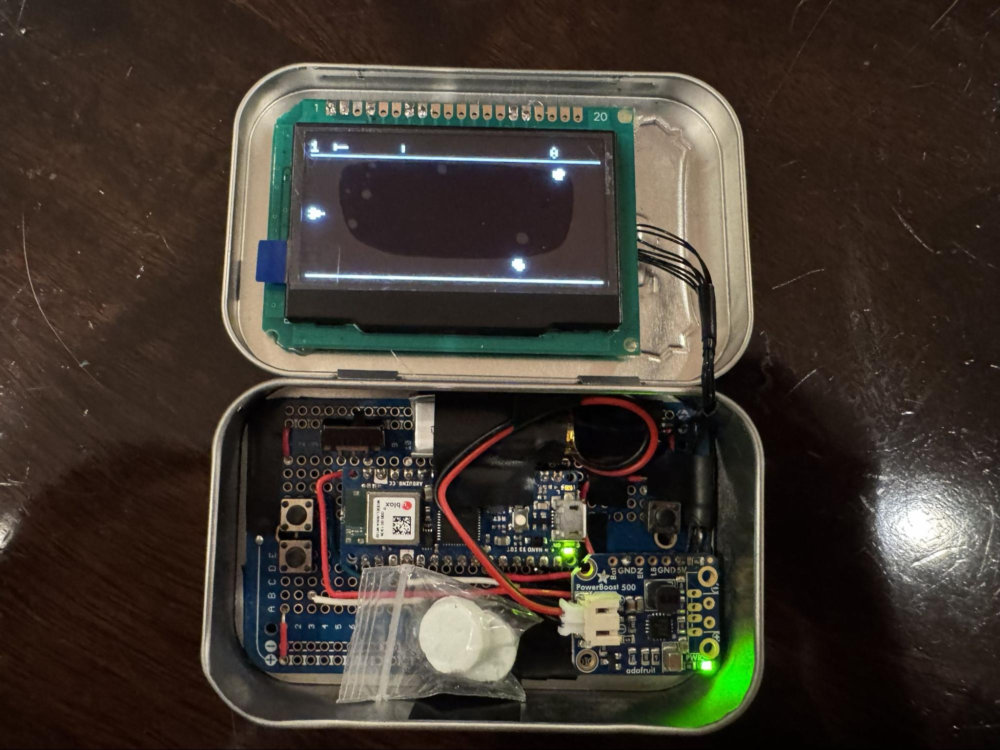
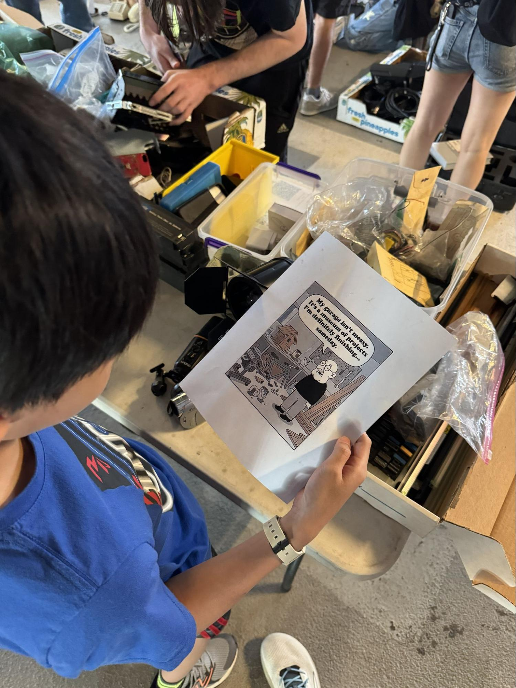
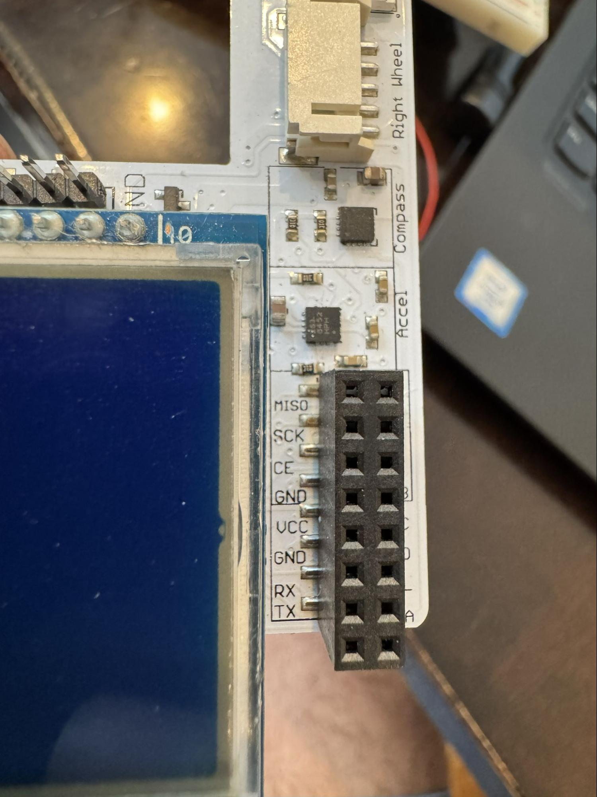
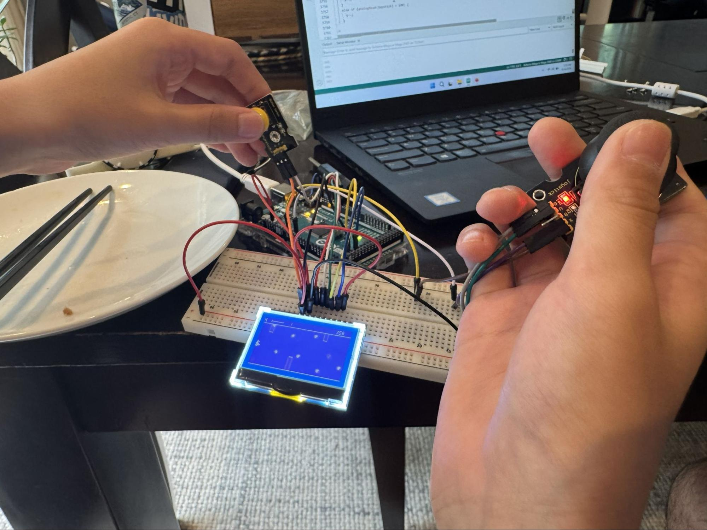
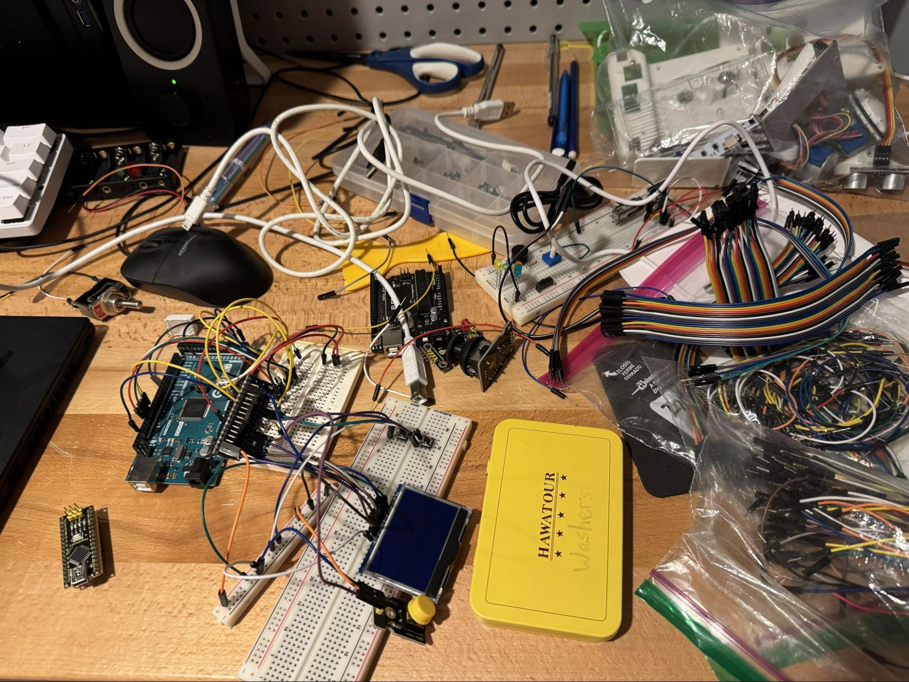
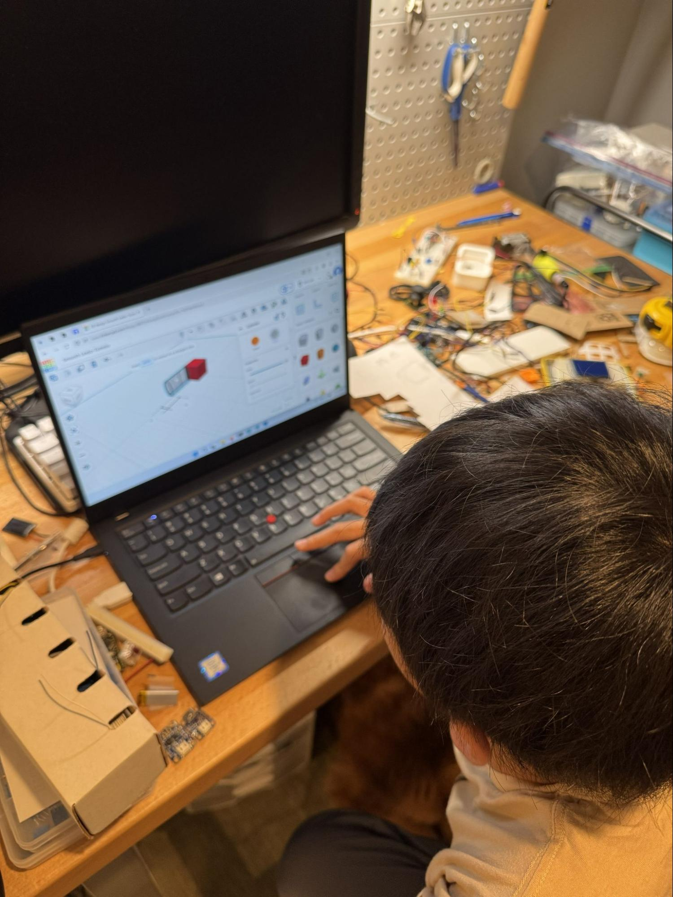
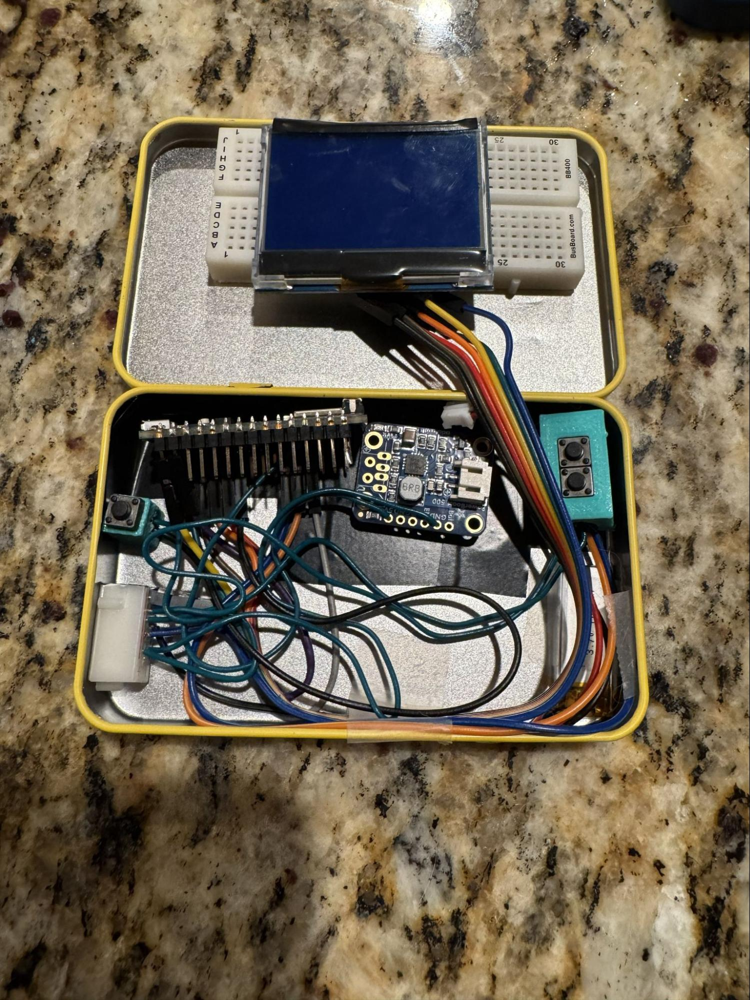
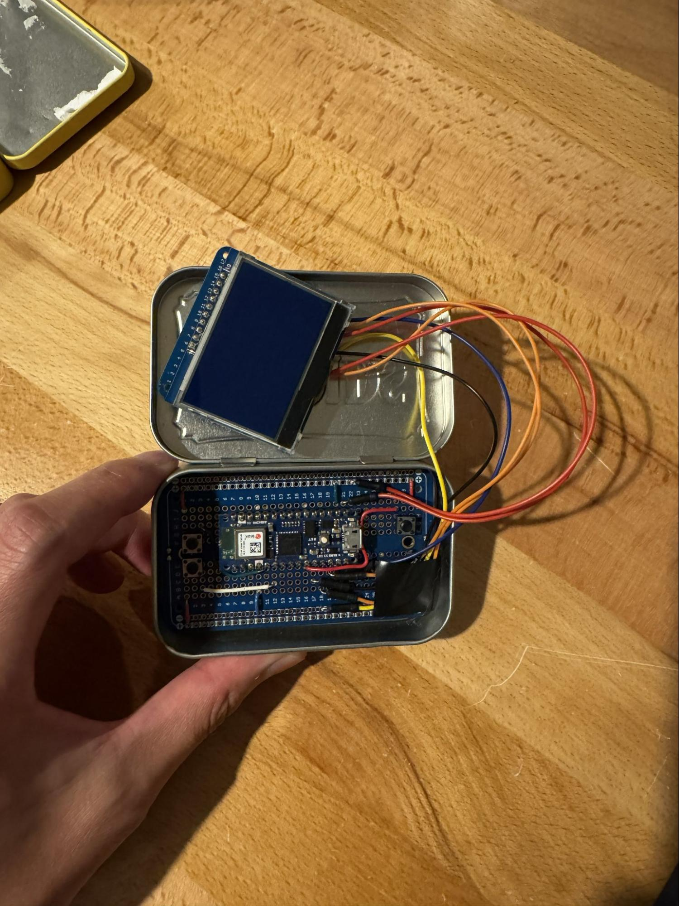
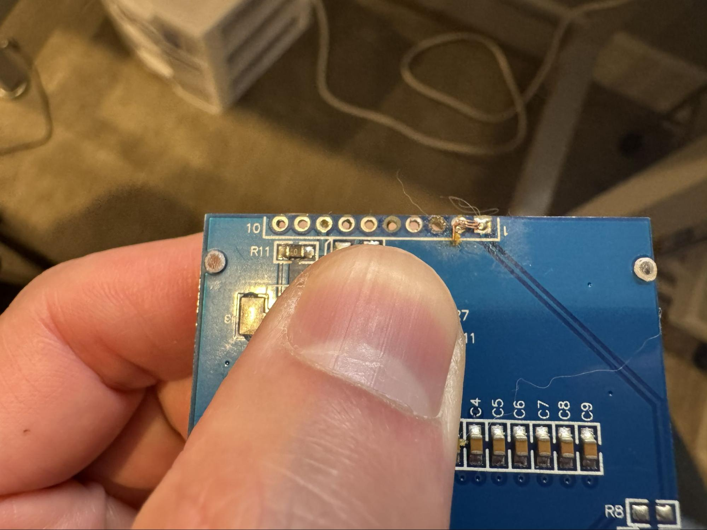
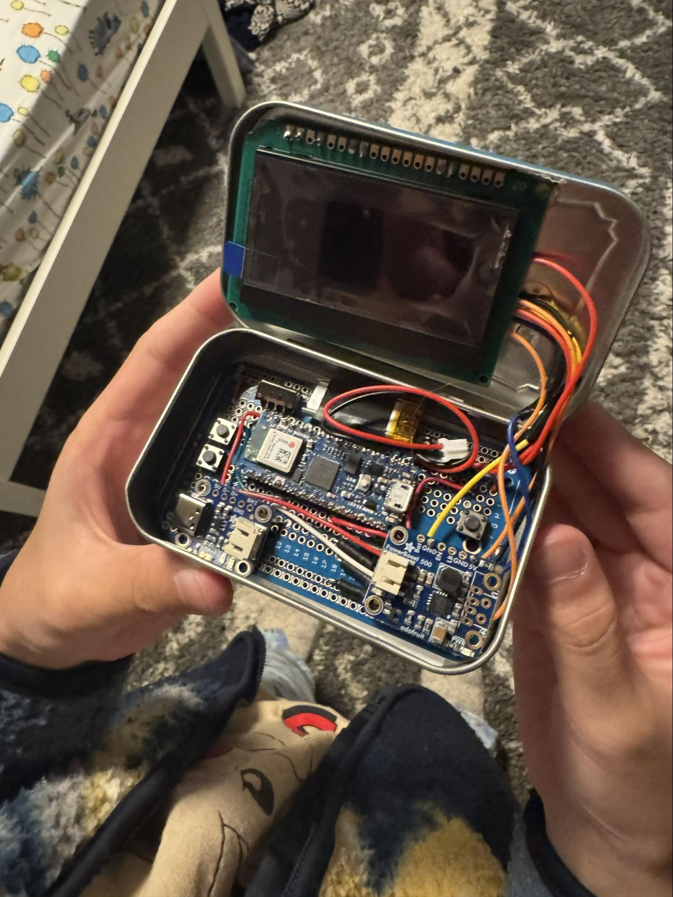

My 12-year-old son and I spent about two months on, what we call, the Altoids project. Here is the final product ([video](/assets/altoids_final_product.mp4)):

It all started when I took him to [MIT Swapfest](https://w1mx.mit.edu/flea-at-mit/) for the first time. We saw an assembled robot from a couple's booth - later we learned that it was from a [kit](https://arcbotics.com/products/sparki/). It was built by their daughter many years ago. After realizing I came with my son, they gave us the robot for free. We also picked up an used Thinkpad laptop at a very reasonable price, which we used for the project.

As any curious minds would, we disassembled the robot. Noticing that we were missing the control, we wanted to see which parts we can reuse. We took the 128x64 display off. But we couldn't find the pinout for the display. We tried using AI, but it hallucinated so badly that it gave us a 20-pin pinout when the display only has 10 pins. 

After hours of searching around, we found the exact schematic posted on [Arduino's forum](https://forum.arduino.cc/t/how-do-i-interface-with-this-board/1081036/6) by a stranger on the Internet. God bless him. With the pinout, we finally made the display show something. We ran the Space Trash game from the [U8g2 library](https://docs.arduino.cc/libraries/u8g2/). Let's call this v1.

I just watched a YouTube video back then where someone built a tiny computer and fit everything inside an Altoids tin ([video](https://www.youtube.com/watch?v=j262kCYZxZI)). Inspired by the YouTube video, we grabbed a random tin found in the house, and moved the project to the workbench.

To reduce the form factor, we switched to an [Arduino Nano](https://store-usa.arduino.cc/products/arduino-nano?srsltid=AYCX9vLszB_8WKeidrfy7vbkKgllZJpfZjhisB8bArShU57nL3MPkvbe); ordered LiPo batteries and [PowerBoost](https://www.adafruit.com/product/2030?srsltid=AYCX9vLchbg7UqiSZzji1AcykGcQKI_v7FP2HFBV0wcIXu_S1kUjgqqI) for power supply. Everything needed to fit in the tin. My son did all the CAD and 3D printing.

Here is what v2 looked like. The lid did not close. It felt like playing 3D chess to fit everything in.

We ordered solderable breadboards to avoid the messy wires. It was looking promising. We also bought a real tin of Altoids from a grocery store, since the Altoids tin is actually a little taller than the one we were using earlier. This is what v3 looked like. The lid did not close, but we were getting closer.

The display was connected to a tiny solderable breadboard. We wanted to remove it and connect the wires to the display directly. But we had a really hard time with desoldering. We accidentally pulled one copper pad off the display making it unusable. It might be possible to salvage it, but we just ordered a new display from Adafruit.

At this point, I would avoid desoldering as much as I can. So we got those tiny hooks for testing the display ([video](/assets/altoids_display.mp4)). This is when we realized the new display does not default to SPI mode. We did not want to make more changes to the wiring, so we still had to desolder two jumpers. 

I suspected our soldering iron was heating unevenly. We ordered a new soldering iron and it made all the difference. With the new iron, we made rapid progress. We hot-glued the display on the lid. Everything worked for the first time. This is what v4 looked like. The lid did close with some struggle.

Two wires connecting the microcontroller and the display broke the next day. We did many hacks, one of which is to extend the wires by soldering two wires together. It did not work well, obviously. We got some ultra-fine (30 AWG) wires to replace them. At this point, my son did most of the desoldering and soldering work. He actually connected one wire incorrectly, so it did not work at first. It is a good debugging and learning experience. 

As a final touch, we got tiny 1x1-inch ziploc bags and put two actual Altoids in the tin. And here we have the final product, after five iterations. None of the components used in the first iteration survived. 

